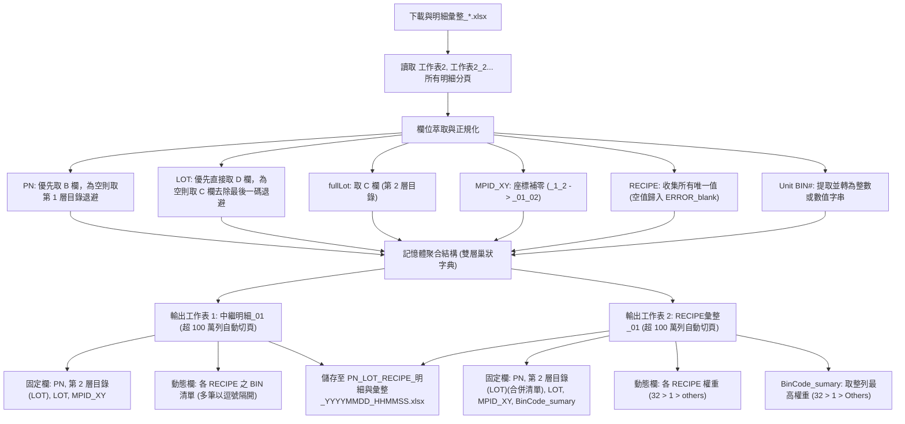

# 微階段 19 實作規劃：彙整資料2 (PN / LOT / RECIPE 交叉樞紐分析與 BIN 權重統計)

本規劃將原 VBA `ExportPNLOTRecipeWithBlankWarning` 完整轉化為高效能 Python 原生架構，透過獨立按鈕「📊 彙整資料2」實現光速樞紐交叉表與晶圓級 BIN 優先權計算。

---

## 一、 模組設計與架構規劃

### 1. 新增核心模組：`core/pivot_aggregator.py`
* **職責**：專責讀取 `下載與明細彙整_*.xlsx` 中的明細工作表，執行記憶體級座標補零、RECIPE 橫向展開與晶片級 BinCode 優先權統計，輸出 `PN_LOT_RECIPE_明細與彙整_YYYYMMDD_HHMMSS.xlsx`。
* **高內聚單一職責**：與原有的 `core/detail_aggregator.py` 清楚分離，避免單一檔案過於龐大，維持程式碼的高可維護性與可測試性。

### 2. 主視窗介面調整：`ui/main_window.py`
* **新增按鈕**：在「`[📊 彙整資料]`」右側新增「`[📊 彙整資料2]`」。
* **按鈕順序**（嚴格維持 12 pt 粗體）：
  1. `[▶ 開始下載]`
  2. `[📊 彙整資料]`
  3. `[📊 彙整資料2]`
  4. `[📑 開啟下載清單 (Excel)]`
  5. `[📁 開啟下載資料夾]`
  6. `[🔍 僅產出清單]`
  7. `[⏹ 停止]`
* **三態狀態機連動 (`_update_aggregate2_btn_state`)**：
  * **灰色停用 (Disabled)**：本地目錄無 `下載與明細彙整_*.xlsx` 時停用。
  * **亮橘高亮 (Highlight)**：存在 `下載與明細彙整_*.xlsx` 但尚未產出對應之 `PN_LOT_RECIPE_*.xlsx`。
  * **綠色完成 (Completed)**：本地已存在產出之樞紐報表，提示可重新產出或開啟。

---

## 二、 核心演算法與資料流設計

---

## 三、 關鍵機制與防呆細節 (對齊 000.md 規範)

1. **座標補零演算法 (`pad_coordinates`)**：
   * 範例：`MPID_1_2` $\rightarrow$ `MPID_01_02`
   * 以底線 `_` 切割字串，若最後兩段長度為 1 且為純數字，前面補 `0`，維持字串天然自然排序。
2. **LOT 智慧取值原則**：
   * **優先取 D 欄 (`LOT`)**：直接反映使用者於主視窗貼上之乾淨母批號，絕不誤切原本有效的批號結尾字元。
   * **退避機制**：若 D 欄為空，取 C 欄去除最後 1 碼（若字元數 $\ge 2$）；若長度 $\le 1$ 則取 C 欄全貌。
3. **PN 絕對防呆**：
   * 若 B 欄有值則直接採用；若為空則退避採用 A 欄第 1 層目錄名稱，保證產出報表中 PN 絕不空白。
4. **BIN 優先權判定演算法 (`calc_bin_rank`)**：
   * 代碼中包含 `32` $\rightarrow$ Rank 3，顯示為 `32`
   * 代碼中包含 `1` $\rightarrow$ Rank 2，顯示為 `1`
   * 代碼中包含其他數值 $\rightarrow$ Rank 1，RECIPE 欄顯示為 `others`，整列彙整顯示為 `Others`
   * 無資料 $\rightarrow$ Rank 0，顯示為空字串
5. **ERROR_blank 特殊處理**：
   * 若來源資料 RECIPE 為空，獨立歸於最右側 `ERROR_blank` 欄。
   * 表頭以深橘底白字（RGB: 156, 74, 0）特別警示。
   * `ERROR_blank` 欄**不參與**整列 `BinCode_sumary` 的綜合權重判定。
6. **100 萬列自動切頁**：
   * 單一 Sheet 上限設定為 1,000,000 列。
   * 超出時自動開新分頁 `中繼明細_02`、`RECIPE彙整_02`，且同一個 (PN, LOT) 群組若能放入新頁，不在舊頁尾端拆碎。

---

## 四、 測試與驗證計畫

1. **單元測試 (`tests/test_phase14_pivot_aggregation.py`)**：
   * 測試 1：座標補零演算法（`_1_2` 轉 `_01_02`、多段底線與非數字容錯）。
   * 測試 2：LOT 取值邏輯（D 欄優先、C 欄退避）。
   * 測試 3：BinCode 權重判定（32 優先、1 次之、others 最低、多值逗號分離）。
   * 測試 4：中繼明細與 RECIPE 彙整雙 Sheet 產出與欄位樣式。
   * 測試 5：UI 按鈕新增、12pt 粗體字型驗證與三態狀態切換。
2. **全套回歸測試 (`tests/test_all.py`)**：
   * 整合 13 大單元與整合測試套件，確保 100% 通過。
3. **發布套裝打包**：
   * 重新執行 `build_exe.py` 與 `build_portable.py`。
